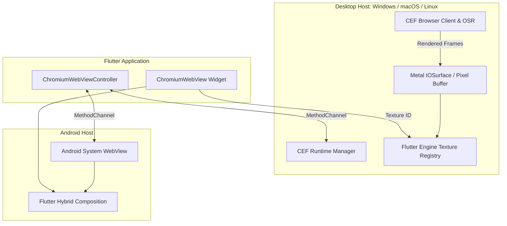

# Flutter Chromium WebView

[](https://pub.dev/packages/flutter_chromium_webview)
[](https://pub.dev/packages/flutter_chromium_webview_platform_interface)
[](LICENSE)

An industrial-grade Chromium webview plugin for Flutter targeting **Windows**, **macOS**, **Linux**, and **Android**.

On desktop operating systems, it embeds the [Chromium Embedded Framework (CEF)](https://bitbucket.org/chromiumembedded/cef) with Off-Screen Rendering (OSR) directly into Flutter textures. On Android, it integrates the installed system Chromium WebView using Flutter's native platform view mechanism.

---

## Target Versions

- **`flutter_chromium_webview`**: `0.5.3`
- **`flutter_chromium_webview_platform_interface`**: `0.1.6`

---

## Supported Platforms

| Platform | Engine | Rendering Mechanism | Status | Details |
|---|---|---|---|---|
| **macOS 13+** | CEF 149 (Chromium 149) | Accelerated IOSurface via Metal | Supported (`arm64` & `x86_64`) | [MACOS.md](packages/flutter_chromium_webview/MACOS.md) |
| **Windows 10+** | CEF 149 (Chromium 149) | Software pixel buffer to Texture | Supported (`x64`, sandboxed bootstrap runner) | [WINDOWS.md](packages/flutter_chromium_webview/WINDOWS.md) |
| **Linux** | CEF 149 (Chromium 149) | Software pixel buffer to Texture | Supported (`x64`, X11 / XWayland via GTK3) | [LINUX.md](packages/flutter_chromium_webview/LINUX.md) |
| **Android (API 24+)** | System Chromium WebView | Native Platform View (Hybrid Composition) | Supported (ARM64, ARM32, x86_64) | [ANDROID.md](packages/flutter_chromium_webview/ANDROID.md) |
| **iOS** | WebKit (`WKWebView`) | Headless prototype | Source only; **not registered in plugin** | [IOS.md](packages/flutter_chromium_webview/IOS.md) |
| **Web** | N/A | N/A | Not implemented | N/A |

---

## Architecture Overview



- **Desktop (CEF OSR)**: Chromium runs in separate helper processes and paints frames off-screen. Frames arrive via native callbacks and are passed to Flutter's texture registry (using accelerated Metal `IOSurface` textures on macOS, and retained pixel buffers on Windows/Linux). The browser widget integrates seamlessly into the Flutter tree with full clipping, transformation, and stacking support.
- **Android**: Uses Android's system `WebView` provider via Flutter Platform Views (Hybrid Composition) with native virtual keyboard, touch input, and accessibility handling.

---

## SDK & System Requirements

- **Dart SDK**: `>=3.12.0 <4.0.0`
- **Flutter SDK**: `>=3.44.0`
- **macOS**: macOS 13+, Xcode 15+, CMake 3.19+, Python 3, CocoaPods.
- **Windows**: Windows 10/11 x64, Visual Studio 2022 (C++ desktop), CMake 3.19+.
- **Linux**: Linux x64, GTK 3 (`libgtk-3-dev`), Clang, CMake 3.19+, Ninja, PulseAudio.
- **Android**: Android API 24+ (Android 7.0+), Java 17, Android compile SDK 36.

---

## Installation & Setup

Add `flutter_chromium_webview` to your dependencies in `pubspec.yaml`:

```yaml
dependencies:
  flutter_chromium_webview: ^0.5.3
```

### Platform Setup Guides

Because desktop platforms embed a dedicated browser engine, each platform requires one-time project configuration:
- **macOS**: See [MACOS.md](packages/flutter_chromium_webview/MACOS.md) (Runner configuration, CocoaPods hook, App Sandbox setting).
- **Windows**: See [WINDOWS.md](packages/flutter_chromium_webview/WINDOWS.md) (Sandboxed runner bootstrap integration).
- **Linux**: See [LINUX.md](packages/flutter_chromium_webview/LINUX.md) (System dependencies and automated CEF download).
- **Android**: See [ANDROID.md](packages/flutter_chromium_webview/ANDROID.md) (API level and WebView provider setup).

---

## Quick Start Example

Initialize the runtime once in `main()` before displaying any web view:

```dart
import 'package:flutter/material.dart';
import 'package:flutter_chromium_webview/flutter_chromium_webview.dart';
import 'package:path_provider/path_provider.dart';

Future<void> main() async {
  WidgetsFlutterBinding.ensureInitialized();

  final cache = await getApplicationSupportDirectory();
  final initialized = await ChromiumWebViewController.initialize(
    cachePath: cache.path,
  );
  if (!initialized) {
    throw StateError('Failed to initialize Chromium runtime');
  }

  runApp(const MyApp());
}

class MyApp extends StatefulWidget {
  const MyApp({super.key});

  @override
  State<MyApp> createState() => _MyAppState();
}

class _MyAppState extends State<MyApp> {
  final controller = ChromiumWebViewController();

  @override
  Widget build(BuildContext context) {
    return MaterialApp(
      home: Scaffold(
        appBar: AppBar(title: const Text('Chromium WebView Demo')),
        body: ChromiumWebView(
          controller: controller,
          initialUrl: 'https://flutter.dev',
        ),
      ),
    );
  }
}
```

---

## Key Features

- **Navigation & Loading**: Full URL loading, raw HTML strings with custom base URLs, history navigation (`goBack`, `goForward`, `reload`), and reactive loading status.
- **JavaScript Engine**: Expression evaluation with parsed JSON return values (`evaluateJavaScript`) and script execution (`executeJavaScript`).
- **Two-Way JavaScript Bridge**: Origin-restricted `JavaScriptChannel`s with UTF-8 size limits and secure message post protocols.
- **Cookies & Sessions**: Application cache directories, isolated named storage profiles, and ephemeral in-memory autoplay contexts.
- **Multiple Instances**: Full support for running multiple simultaneous independent web views on screen.
- **Custom Native UI**: Custom Flutter-rendered JavaScript dialogs (`alert`, `confirm`, `prompt`) and right-click context menus.
- **Crash Recovery**: Automatic notification (`onBrowserCrashed`) and document recreation on renderer or GPU subprocess crashes.
- **YouTube Playback Integration**: Dedicated `ChromiumYoutubePlayerController` with native telemetry, iframe API synchronization, and autoplay support.

---

## Running the Example Application

From `packages/flutter_chromium_webview/example`:

```bash
flutter pub get

# Run on your desktop platform
flutter run -d macos
flutter run -d windows
flutter run -d linux

# Or on Android
flutter run -d <android-device-id>
```

---

## Known Limitations

- **Proprietary Codecs**: Distributed CEF builds do not include proprietary H.264 or AAC codecs. Open codecs (VP8, VP9, AV1, Vorbis, Opus) are fully supported.
- **macOS App Sandbox**: macOS CEF currently requires direct distribution outside Apple's App Sandbox. See [MACOS.md](packages/flutter_chromium_webview/MACOS.md).
- **Process Lifecycle**: CEF cannot be re-initialized in the same process after `CefShutdown()` has completed without restarting the application.
- **macOS Extended Memory**: Validated tracked cleanup and empty survivor checks pass; physical 8 GB target testing and long-term soak profiling remain tracked release follow-ups.

---

## Repository Structure

```
flutter_chromium_webview/
├── packages/
│   ├── flutter_chromium_webview/                   # Main Flutter plugin (0.5.3)
│   │   ├── example/                                # Example browser app
│   │   ├── lib/                                    # Dart API
│   │   ├── macos/                                  # macOS CEF & Metal backend
│   │   ├── windows/                                # Windows CEF backend
│   │   ├── linux/                                  # Linux CEF backend
│   │   ├── android/                                # Android WebView backend
│   │   └── ios/                                    # iOS prototype (unregistered)
│   └── flutter_chromium_webview_platform_interface/ # Platform interface (0.1.6)
│       └── example/                                # Platform interface example
├── docs/                                           # Architecture and technical guides
└── scripts/                                        # Native validation and smoke tests
```

---

## License

This project is licensed under the [MIT License](LICENSE).  
Chromium and CEF are distributed under their respective BSD-style licenses.
