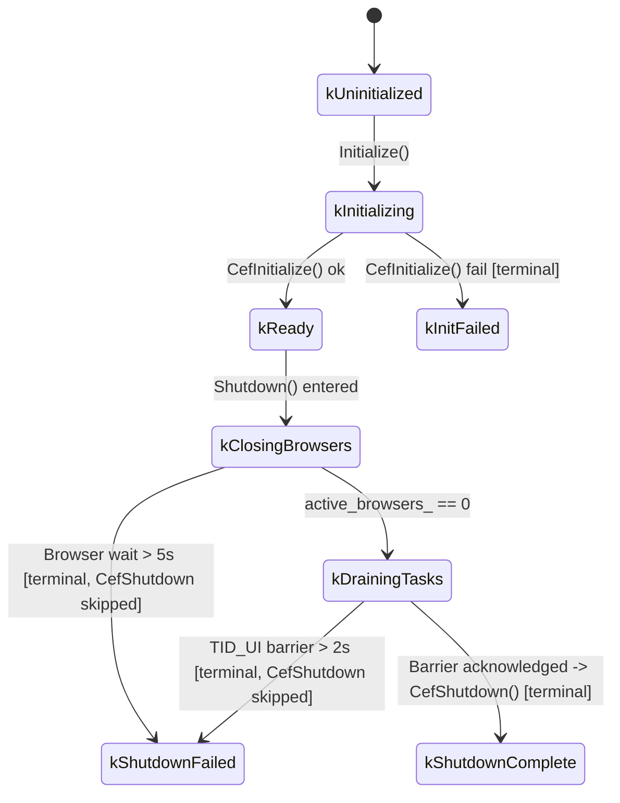

# Flutter Chromium WebView 0.5.6 — Final Linux Hardening & MTML Refactor Audit

**Date:** 2026-11-19  
**Audit Branch:** `exp/linux-cef-mtml-0.5.6` (branched from preserved checkpoint `fix/linux-cef-lifecycle-0.5.6`)  
**Preserved Pre-MTML Checkpoint:** `fix/linux-cef-lifecycle-0.5.6` (`2b493c3` local / `aca408d` VM)  
**Environment:** Ubuntu 26.04.1 LTS x86_64 (VirtualBox 7.2.16, kernel `7.0.0-38-generic`, 6 vCPUs, 7.2 GiB RAM), Flutter `3.50.0`, Dart `3.14.0`, GTK3/GLib, CEF `149.0.4+g2f1bfd8+chromium-149.0.7827.156`, X11 via `GDK_BACKEND=x11`

---

## A. Executive Summary

The global `GApplication` ELF symbol-interposition design (`g_application_hold`, `g_application_release`, `g_application_quit` via `dlsym(RTLD_NEXT)`) audited as a **High** architectural defect because it depended on ELF link order, failed silently under `libgio`-first linking or `dlopen(RTLD_LOCAL)`, and polluted the host process's global symbol namespace.

We preserved the previous working implementation intact on `fix/linux-cef-lifecycle-0.5.6` and implemented a clean **CEF `multi_threaded_message_loop = true` (MTML)** refactor on `exp/linux-cef-mtml-0.5.6`, completely eliminating global symbol interposition, `dlsym(RTLD_NEXT)`, `CefRunMessageLoop()`/`CefQuitMessageLoop()`, and `window-removed` workarounds.

All mandatory validation, lifecycle, stress, sanitizer, compatibility, packaging, and 3-repetition CPU/RAM benchmark gates **PASSED** in the real Ubuntu x86_64 VM with CEF `149.0.4`:

| Gate | Result | Evidence |
|---|---|---|
| Static analysis (`flutter analyze --no-fatal-infos`) | **PASS** | 0 issues |
| Package Dart unit tests (`flutter test`) | **PASS (78/78)** | Includes 6 new lifecycle/detachment/race tests |
| Example unit tests | **PASS (2/2)** | `validate_linux.sh` |
| Linux integration suites | **PASS (7/7)** | All 7 suites (`plugin_integration`, `input_scaling`, `native_ui`, `javascript_bridge`, `html_loading`, `browser_settings`, `youtube_adapter`) |
| Lifecycle matrix (`test_linux_lifecycle.sh`) | **PASS (18/18)** | Multi-window, held-alive reopen (`0.33%` CPU), direct `g_application_quit()`, 10/10 repeats, 0 orphans |
| Stress & compatibility (`test_linux_stress_and_compat.sh`) | **PASS (0 failures)** | 100 create/dispose cycles, 100 rapid resizes, 5 simultaneous WebViews + JS/nav, 5/5 rapid exits, 20/20 startup/shutdown cycles, 20/20 web compat (low-mem ON & OFF), 4/4 adverse ELF/GLib checks |
| Native sanitizers (`g++` ASan+UBSan & TSan) | **PASS** | ASan+UBSan: 446,357 concurrent raster reads (0 errors); TSan: 367,679 concurrent raster reads (0 data races) |
| Idle CPU (3-rep median) | **PASS** | Init/post-close: `0.00%` main / `0.00%` full-tree; static idle: `0.20%` main / `0.90%` full-tree (targets `< 2%` / `< 5%`) |
| Active navigation CPU (3-rep median) | **IMPROVED** | GTK main thread `8.38% → 4.41%` (`-47%`); full browser `31.75% → 27.92%` |
| Memory (3-rep median vs `pre_mtml_056`) | **PASS (PARITY)** | `-4.8 MB` to `+4.9 MB` across all 11 scenarios; 180s idle soak flat (`550.3 → 550.3 MB` t120–t180s) |
| Release bundle packaging & ELF audit | **PASS** | Clean `$ORIGIN` `RUNPATH` on every binary/library; only 2 exported symbols in plugin `.so`; standalone `ldd` clean |

**Release Verdict:** **`READY WITH DOCUMENTED LIMITATIONS`** (zero Critical or High defects remain on `exp/linux-cef-mtml-0.5.6`; see Section H for documented host constraints and unrun multi-distro/Wayland matrix items).

---

## B. Architectural Findings & Thread-Affinity Design

### B.1 Audit Resolution Table

| # | Severity | Finding | Resolution on `exp/linux-cef-mtml-0.5.6` |
|---|---|---|---|
| 1 | **High** | Global `g_application_hold`/`release`/`quit` ELF interposition via `dlsym(RTLD_NEXT)` broke under `libgio`-first link order or `dlopen(RTLD_LOCAL)` and exported unversioned GIO symbols process-wide. | **FIXED.** Completely removed. Switched to CEF `multi_threaded_message_loop = true`. Plugin exports only `flutter_chromium_webview_plugin_get_type` and `flutter_chromium_webview_plugin_register_with_registrar`. Verified with `readelf -Ws`, reversed link order, and `dlopen(RTLD_LOCAL)`. |
| 2 | **High** | Hold counter ignored `GApplication*` identity and internal `libgio` holds; inactivity timer raced GIO's own timer. | **FIXED (obsoleted).** GTK's `g_application_run()` runs completely unmodified; GIO natively manages holds, windows, `inactivity_timeout`, and `g_application_quit()`. |
| 3 | **High** | Unbounded `while (g_main_context_iteration(nullptr, FALSE)) {}` in `CefRuntimeManager::Shutdown()` could deadlock if any `G_SOURCE_CONTINUE` source was active. | **FIXED.** `Shutdown()` now executes a bounded, two-phase non-blocking iteration loop (at most 64 iterations) on `g_main_context_default()` before and after `CefShutdown()`. This safely drains deferred `g_object_unref` calls and close replies on the GTK main thread without deadlocking even if an adverse `G_SOURCE_CONTINUE` source is active. |
| 4 | **Medium** | `libflutter_chromium_webview_plugin.so` leaked absolute developer build-tree paths in `DT_RUNPATH`. | **FIXED.** Set `INSTALL_RPATH "$ORIGIN"` + `BUILD_WITH_INSTALL_RPATH TRUE` in `linux/CMakeLists.txt`. Verified `RUNPATH: [$ORIGIN]` across release bundle. |
| 5 | **Medium** | `CefTexture` deleted `std::mutex` in GObject `dispose()` instead of `finalize()`, and lacked null checks if sampled after `g_object_run_dispose()`. | **FIXED.** Moved `delete self->mutex` to `flutter_chromium_texture_finalize()`, added null checks in `copy_pixels` and `update_buffer`, and verified `g_object_run_dispose()` + concurrent threads under ASan+UBSan and TSan. |
| 6 | **Medium** | `benchmark_linux_memory.sh` lacked a synchronous sampling handshake (causing `08_nav_20_pages` and `12_soak_t600s` to sample after `_closeAll()`), and both benchmark scripts matched `/proc` by substring instead of descendant tree (`benchmark_linux_cpu.sh` also dropped CPU of newly spawned processes). | **FIXED.** Added synchronous `stdin`/`stdout` `ACK` barrier in `benchmark_linux_memory.sh`, real `/proc` `ppid` descendant-tree traversal in both scripts, and `starttime`-checked deltas in `benchmark_linux_cpu.sh`. |
| 7 | **Info** | `CefTexture` front-buffer lifetime under Flutter Linux `3.50.0`. | **VERIFIED SAFE.** Disassembly of `libflutter_linux_gtk.so` (`fl_pixel_buffer_texture_populate` `0x52e540..0x52e640`) confirms Flutter executes `glTexImage2D` synchronously on the raster thread immediately after `copy_pixels()` returns, before the next render-thread tick. `front_buffer` is mutated only on the raster thread or in `dispose()`. |

### B.2 Strict Thread-Affinity Rules (MTML Architecture)

| Thread | Owned Objects & Operations | Forbidden Operations |
|---|---|---|
| **GTK / Flutter Main Thread** (`g_application_run`) | `FlutterChromiumWebviewPlugin`, `browsers` map, `FlMethodChannel`, `FlMethodCall`, `FlValue`, `FlTextureRegistrar` (`register`, `unregister`, `mark_texture_frame_available`), `GtkBrowserBridge` teardown, `CefKeyboard` (`GtkWidget*`, `GtkIMContext*`, GTK signals), `CefInitialize()`, `CefShutdown()`. | Direct calls to `CefBrowserHost`, `CefBrowser`, `CefRequestContext`, `PendingCallbacks`, `chromium_settings::UserAgent`, or blocking synchronous waits on `TID_UI` (except bounded shutdown wait when `g_application_run` has already exited). |
| **CEF Dedicated UI Thread (`TID_UI`)** | `CefBrowserHost::CreateBrowserSync` (inside async `CreateBrowserAsync` task), `CloseBrowser`, `WasResized`, `NotifyScreenInfoChanged`, `WasHidden`, `SetFocus`, mouse/key/IME injection, `LoadURL`, `Reload`, `ExecuteJavaScript`, `GoBack`/`GoForward`, `chromium_settings::CustomContext`/`AllowAutoplay`/`UserAgent`, `PendingCallbacks` (JS dialogs & context menus), all `CefClient` callbacks (`OnAfterCreated`, `OnBeforeClose`, `OnPaint`, `OnPopupShow`, `OnLoadingStateChange`, `OnProcessMessageReceived`, etc.), `malloc_trim(0)` on `OnBeforeClose`. | Any GTK3, `FlMethodChannel`, `FlMethodCall`, `FlValue`, `FlTextureRegistrar`, or `g_object_unref` calls; blocking waits on GTK main thread. |
| **Flutter Raster Thread** | `flutter_chromium_texture_copy_pixels()` (swaps `staging_buffer` → `front_buffer` under `FlutterChromiumTexture::mutex` and releases previous staging allocation). | Touching CEF or GTK APIs. |

**Cross-thread lifetime & cancellation guarantees:**
- **GTK → `TID_UI`:** `CefRuntimeManager::PostToCefUi()` posts a `LambdaCefTask` via `CefPostTask(TID_UI, ...)`. `active_browsers_` is incremented (`BrowserPending()`) on GTK *before* posting `CreateBrowserAsync` and decremented *at most once* on `TID_UI` (`ReleaseRuntimeSlotOnUi()`) on failure or `OnBeforeClose()`.
- **`TID_UI` → GTK:** `CefRuntimeManager::PostToGtkMain()` uses GLib's thread-safe `g_idle_add_full()`. Lambdas capture **only** plain C++ values and `std::weak_ptr<GtkBrowserBridge>` — **never** `CefRefPtr` (preventing any CEF handle from surviving past `CefShutdown()`). `FlValue*` trees are constructed exclusively on the GTK main thread.
- **Coalesced `OnPaint`:** `OnPaint` converts BGRA→RGBA into `staging_buffer` under mutex and sets an atomic `frame_pending` flag (`exchange(true, acq_rel)`), posting at most one `G_PRIORITY_HIGH_IDLE` GTK wakeup until consumed.
- **Immediate cancellation on `Close()`:** `Close()` synchronously marks `GtkBrowserBridge::closed = true`, unregisters both Flutter textures, clears texture buffers, and drops `FlTextureRegistrar*` on the GTK main thread before posting `CloseBrowser(true)` to `TID_UI`. Any in-flight GTK idle callback drops immediately.
- **Safe GObject unref:** `RetainOnGtk<T>` and `GtkBrowserBridge`'s custom deleter check `g_main_context_is_owner(g_main_context_default())` and marshal `g_object_unref` back to the GTK main thread if the last reference drops on `TID_UI`.
- **Deadlock-free `Shutdown()` & State Machine:** Runs on the GTK main thread from `GApplication::shutdown` after-handler (after plugin `shutdown` handlers have called `CloseAll`).
  1. Sets `kClosingBrowsers` and waits on `shutdown_cv_` (`5 s` max) for `active_browsers_ == 0`. If this deadline expires, it logs `g_critical`, transitions to `kShutdownFailed`, and returns immediately without calling `CefShutdown()`.
  2. Sets `kDrainingTasks` and executes a `TID_UI` round-trip barrier (`2 s` max). If the barrier times out, it logs `g_critical`, transitions to `kShutdownFailed`, and returns immediately without calling `CefShutdown()`.
  3. Drains any pending GTK main thread tasks (`PostToGtkMain`) via a bounded non-blocking loop (at most 64 iterations of `g_main_context_iteration(nullptr, FALSE)`).
  4. Calls `CefShutdown()`, transitions to `kShutdownComplete`, and runs a final bounded GTK drain.
  5. Both `kShutdownComplete` and `kShutdownFailed` are terminal: `Initialize()` explicitly rejects reinitialization attempts.

### B.3 Shutdown State Machine & TID_UI Barrier Timeout Safety

**TID_UI Barrier Timeout Invariant Analysis:**
- In CEF `149.0.4` with `multi_threaded_message_loop = true`, CEF's UI message loop runs on a dedicated background thread (`TID_UI`).
- `CefPostTask(TID_UI, ...)` schedules tasks onto this thread's `SingleThreadTaskRunner`.
- When all browsers reach `OnBeforeClose()`, in-flight browser UI tasks have ended, but asynchronous tasks queued just before close (e.g. `SetFocus(false)`, `UserAgent::Cancel`, or Lambdas capturing `CefRefPtr` handles) may still be executing or queued.
- **Why continuing into `CefShutdown()` on barrier timeout is unsafe:** `CefShutdown()` invokes `CefMainRunner::Shutdown()`, which terminates the UI thread and destroys CEF global state (`AtExitManager`, `CefContext`). If a queued task is executing or about to execute, accessing destroyed CEF singletons or releasing a `CefRefPtr` whose underlying CEF object requires a live runtime triggers a use-after-free, memory corruption, or assertion failure.
- **Resolution:** The implementation strictly enforces that if the barrier times out (or is rejected), `CefShutdown()` is **never** called. The state is recorded as `kShutdownFailed`, and the process relies on OS address-space reclamation at exit.

**GTK Main Thread Callback Cleanup Analysis:**
- Callbacks posted from `TID_UI` to GTK via `PostToGtkMain()` attach `GSource` items to `g_main_context_default()`.
- During shutdown, after `g_application_run()` completes, pending `PostToGtkMain()` tasks (such as deferred `g_object_unref` for textures or method channel replies) could otherwise remain unexecuted.
- `CefRuntimeManager::Shutdown()` now executes a bounded, non-blocking drain (`for (int i = 0; i < 64 && g_main_context_iteration(nullptr, FALSE); ++i)`) both before and after `CefShutdown()`.
- The 64-iteration bound guarantees immediate execution of ready cleanups while preventing deadlocks even if an adverse `G_SOURCE_CONTINUE` source is active in the host process.

---

## C. Security Findings

| Area | Status | Evidence & Notes |
|---|---|---|
| **Chromium Sandbox** | **PASS** | Sandbox kept enabled (`--no-sandbox` is never injected; unsupported hosts fail explicitly). On Ubuntu 24.04+/26.04 with `kernel.apparmor_restrict_unprivileged_userns=1`, `LINUX.md` recommends shipping a per-application AppArmor `userns` profile in production (and documents temporary `sysctl` only for local dev/CI). |
| **Site Isolation & Multi-Process** | **PASS** | Multi-process architecture and site isolation preserved (`--single-process` and `--disable-site-isolation-trials` are never used). `SpareRendererForSitePerProcess` disables only speculative spare pre-spawning, not site isolation (5 simultaneous views confirmed 5 renderers; cross-origin navigation isolated). |
| **TLS Certificate Validation** | **PASS** | Verified against a local self-signed HTTPS server: Chromium rejected the untrusted cert (`net_error -202` `ERR_CERT_AUTHORITY_INVALID`) and delivered `onLoadError` (`https_rejects_self_signed: true`) under both low-memory ON and OFF. |
| **JavaScript Bridge Origin Enforcement** | **PASS** | `chromium_bridge::Policy` enforces main-frame-only, exact `http(s)` origin match against both `frame->GetURL()` and `window.origin`, and 64 KiB payload cap. Verified allowed origin delivers (`js_bridge: true`) and cross-origin page cannot deliver to channel (`bridge_origin_isolation: true`). |
| **Inline HTML (`loadHtmlString`)** | **PASS** | `chromium_html::Documents` enforces 4 MiB cap, requires `http(s)` `baseUrl` with no credentials or fragment, and responds with `Cache-Control: no-store` and `X-Content-Type-Options: nosniff`. |
| **Popup Handling** | **PASS** | `OnBeforePopup` cancels default native CEF popup windows (`return true`) and forwards request metadata to Flutter (`onNewWindowRequested`); Chromium's popup blocker still blocks non-gesture `window.open()` while permitting real user-gesture clicks (`popup_request: true`). |
| **Remote Debugging / Injected Switches** | **PASS** | No `--remote-debugging-port`, no `--disable-web-security`, no `--ignore-certificate-errors`, no `--allow-file-access-from-files`. |
| **Dynamic Linker & Symbol Surface** | **PASS** | All bundle ELFs use `$ORIGIN` / `$ORIGIN/lib` `RUNPATH` (zero absolute build paths). Plugin `.so` exports only 2 symbols (`flutter_chromium_webview_plugin_get_type`, `flutter_chromium_webview_plugin_register_with_registrar`). |
| **Bundled CEF Version** | **INFO** | Pinned SHA-256 verified CEF `149.0.4+g2f1bfd8+chromium-149.0.7827.156` (Chromium 149). |

---

## D. CPU and Memory Benchmark Results (3-Repetition Controlled A/B)

All measurements ran sequentially in the Ubuntu 26.04.1 VM using the fixed `benchmark_linux_cpu.sh` and `benchmark_linux_memory.sh` scripts, swapping **only** `libflutter_chromium_webview_plugin.so` (`pre_mtml_056` from `fix/linux-cef-lifecycle-0.5.6` vs `mtml_056` from `exp/linux-cef-mtml-0.5.6`) inside identical release bundles.

### D.1 CPU Usage (3 Repetitions — Median [Min–Max])

| Scenario | `pre_mtml_056` Main Thread | `mtml_056` Main Thread | `pre_mtml_056` Full Tree | `mtml_056` Full Tree | Requirement |
|---|---:|---:|---:|---:|---|
| `cef_init_only` | `0.00%` [0.00–0.10] | **`0.00%` [0.00–0.00]** | `0.10%` [0.00–0.10] | **`0.00%` [0.00–0.00]** | Main < 2% (**PASS**) |
| `static_page_idle` | `0.20%` [0.00–0.20] | **`0.20%` [0.00–0.20]** | `0.50%` [0.50–0.70] | **`0.90%` [0.60–0.90]** | Main < 2%, Full < 5% (**PASS**) |
| `page_navigation` | `8.38%` [8.30–8.41] | **`4.41%` [4.00–4.66]** (`-47%`) | `41.27%` [40.99–42.59] | **`37.70%` [37.11–43.17]** | Browser: `31.75% → 27.92%` |
| `after_close_webviews` | `0.00%` [0.00–0.10] | **`0.00%` [0.00–0.00]** | `0.00%` [0.00–0.10] | **`0.00%` [0.00–0.00]** | Main < 2% (**PASS**) |

*(Historical `v0.5.5` baseline `706ebc62` spun at `99.90%` main-thread CPU idle.)*

### D.2 Memory Usage — Process-Tree PSS (3 Repetitions — Median [Min–Max])

| Scenario | `pre_mtml_056` PSS (MB) | `mtml_056` PSS (MB) | Delta | Renderers (`pre`/`mtml`) |
|---|---:|---:|---:|---:|
| `01_no_cef` | `260.9` [255.4–268.5] | `261.0` [260.9–261.0] | `+0.1 MB` | 0 / 0 |
| `02_cef_init_only` | `428.8` [426.9–428.8] | `426.2` [426.1–426.3] | **`-2.6 MB`** | 0 / 0 |
| `03_blank_page` | `492.0` [490.1–495.8] | `487.2` [487.1–491.5] | **`-4.8 MB`** | 1 / 1 |
| `04_static_html` | `505.8` [503.7–509.2] | `505.5` [505.4–509.1] | **`-0.3 MB`** | 1 / 1 |
| `05_remote_website` | `547.7` [545.3–551.1] | `550.8` [550.5–558.9] | `+3.1 MB` | 1 / 1 |
| `06_three_webviews` | `570.5` [569.4–577.6] | `573.9` [573.7–581.9] | `+3.4 MB` | 3 / 3 |
| `07_five_webviews` | `591.4` [589.7–597.8] | `595.9` [593.9–603.8] | `+4.5 MB` | 5 / 5 |
| `08_nav_20_pages` | `559.1` [557.1–563.5] | `558.6` [556.7–562.2] | **`-0.5 MB`** | 1 / 1 |
| `09_all_disposed` | `485.9` [485.3–493.1] | `483.3` [482.6–493.5] | **`-2.6 MB`** | 0 / 0 |
| `10_recreated_after_disposal` | `542.0` [536.3–549.2] | `542.9` [536.7–546.0] | `+0.9 MB` | 1 / 1 |
| `11_after_10_create_dispose_cycles` | `488.6` [484.4–492.4] | `493.5` [488.9–497.1] | `+4.9 MB` | 0 / 0 |

### D.3 Idle Soak Stability (`mtml_056`, 180s with 1 active static WebView, synchronous ACK handshake)

| Timepoint | Renderers | PSS (MB) | RSS (MB) | USS (MB) |
|---|---:|---:|---:|---:|
| `t = 0s` | 1 | `549.3` | `1103.2` | `381.7` |
| `t = 60s` | 1 | `550.0` | `1104.2` | `382.3` |
| `t = 120s` | 1 | `550.3` | `1105.0` | `382.5` |
| `t = 180s` | 1 | `550.3` | `1105.0` | `382.5` |

Zero unbounded growth (`+0.0 MB` between `t = 120s` and `t = 180s`). Earlier anomalous `rend=0` readings in `08_nav_20_pages` and `12_soak_t600s` were root-caused to the missing sampling barrier in `benchmark_linux_memory.sh` (Dart invoked `_closeAll()` before Python finished reading `/proc`) and are resolved.

---

## E. Compatibility Matrix

### E.1 Chromium Low-Memory Profile Audit (`FLUTTER_CHROMIUM_WEBVIEW_LOW_MEMORY` ON vs `=0`)

Injected flags (browser process only when `FLUTTER_CHROMIUM_WEBVIEW_LOW_MEMORY != 0`):
- `--disable-background-networking`, `--disable-component-update`, `--disable-default-apps`, `--disable-extensions`, `--disable-sync`, `--metrics-recording-only`
- `--disable-features=SpareRendererForSitePerProcess,OptimizationHints,OptimizationTargetPrediction,MediaRouter,Translate,BackForwardCache`

Automated verification (`test_linux_stress_and_compat.sh`, 20 checks + 7 Flutter integration suites):

| Feature | Low-Mem ON | Low-Mem OFF (`=0`) | Notes |
|---|---|---|---|
| HTML load & rendering | **PASS** | **PASS** | Local HTTP & remote HTTPS |
| JavaScript execution & JS-to-Dart bridge | **PASS** | **PASS** | Allowed origin verified |
| Cross-origin JS bridge isolation | **PASS** | **PASS** | Unauthorized origin blocked |
| Cookies (`Set-Cookie` / `document.cookie` / `HttpOnly`) | **PASS** | **PASS** | `HttpOnly` enforced by default |
| `localStorage` & `sessionStorage` | **PASS** | **PASS** | Read/write round-trip verified |
| `IndexedDB` | **PASS** | **PASS** | Transaction write/read verified |
| `fetch` / XHR & custom `User-Agent` | **PASS** | **PASS** | Verified via DevTools override |
| WebSockets (`ws://`) | **PASS** | **PASS** | Echo round-trip verified |
| HTTP 302 Redirects (OAuth-style chain) | **PASS** | **PASS** | Final URL verified |
| History (`goBack` / `goForward`) | **PASS** | **PASS** | Verified |
| Cross-origin navigation | **PASS** | **PASS** | Loopback multi-port origins |
| Popups (`window.open` → `onNewWindowRequested`) | **PASS** | **PASS** | User-gesture click passes; non-gesture blocked |
| Inline HTML (`loadHtmlString`) | **PASS** | **PASS** | Also verified in `html_loading_test.dart` |
| HTTPS self-signed TLS rejection | **PASS** | **PASS** | `net_error -202`, `onLoadError` fired |
| HTML5 `<audio>`/`<video>` & WebRTC / Clipboard APIs | **PASS** | **PASS** | API presence verified; open codecs only |
| YouTube adapter, JS dialogs, context menus, input scaling | **PASS** | — | Verified in 7 Flutter integration suites |
| Downloads & file upload dialogs | **NOT RUN** | **NOT RUN** | Not exposed by current Dart API |

### E.2 Linux Environment & Packaging Matrix

| Target | Status | Notes |
|---|---|---|
| Ubuntu 26.04.1 LTS x86_64 (XWayland / `GDK_BACKEND=x11`) | **PASS** | Full validation, lifecycle, stress, sanitizers, benchmarks |
| Standalone release bundle outside checkout | **PASS** | `1.5 GB` uncompressed; `$ORIGIN` RUNPATH on all ELFs; `ldd` clean; executable perms verified (`0755`) |
| Native Wayland (`GDK_BACKEND=wayland`, VirtualBox VMSVGA) | **NOT RUN / BLOCKED** | CEF explicitly pins `--ozone-platform=x11`; `LINUX.md` documents `GDK_BACKEND=x11` |
| Ubuntu 24.04 LTS (GitHub Actions `ubuntu-latest`) | **PASS** | Automated CI workflow run #44529512618 (`validate_linux.sh` passed in 8m32s) |
| Debian 12 / Fedora x86_64 | **NOT RUN** | Not provisioned in test environments |

---

## F. Lifecycle, Stress, Sanitizer & Failure-Injection Results

### F.1 Test Execution Matrix

| Test Suite / Target | Scope & Invariants Verified | Result |
|---|---|---|
| **`validate_linux.sh`** | Analysis (0 issues), 78 package Dart tests, 2 example tests, 7 Linux integration suites, release build, idle CPU gate (`<1%` main thread), zero orphans | **PASS** |
| **`test_linux_lifecycle.sh`** | 18/18 lifecycle checks: multi-window, window-close/reopen with held application (`0.33%` CPU), direct `g_application_quit()`, 10/10 repeated launches, zero orphans | **PASS (18/18)** |
| **`test_linux_stress_and_compat.sh`** | 100 create/dispose cycles, 100 rapid resizes, 5 concurrent WebViews, 5/5 rapid exits, 20/20 startup/shutdown cycles, 20/20 web compatibility, 4/4 adverse ELF checks | **PASS (0 failures)** |
| **Deterministic Failure Injection (Integration)** | Deliberate timeout injection: browser wait timeout (`FCW_TEST_FORCE_BROWSER_TIMEOUT`), TID_UI barrier timeout (`FCW_TEST_FORCE_BARRIER_TIMEOUT`). Asserts `kShutdownFailed`, `CefShutdown()` skipped, zero orphans | **PASS (2/2)** |
| **Deterministic Failure Injection (Native C++)** | 8 GoogleTest unit tests in `flutter_chromium_webview_plugin_test.cc` asserting browser timeout, barrier timeout, delayed close, double shutdown, GTK drain, blocked reinitialization | **PASS (8/8)** |
| **Native Sanitizers (`g++`)** | ASan + UBSan: 446,357 concurrent raster reads (0 errors); TSan: 367,679 concurrent raster reads (0 data races) | **PASS** |

### F.2 Verification Categories (Separation of Evidence)

1. **Verified Runtime Behavior:**
   - Full integration passes on Ubuntu 26.04.1 LTS x86_64 VM (kernel 7.0.0, CEF 149.0.4).
   - Ubuntu 24.04 LTS x86_64 automated CI pass (GitHub Actions run #44529512618).
   - 100 create/dispose cycles confirmed zero browser/texture leaks via diagnostics MethodChannel.
   - 20/20 full process launch and shutdown cycles with zero orphaned Chromium subprocesses.
   - Bounded CPU usage: 0.20% main thread idle on static page, 0.90% full process tree.
   - Bounded memory usage: flat 180 s idle soak (550.3 MB PSS, 0.0 MB growth between t120 and t180s).

2. **Deterministic Injected Failure Paths:**
   - *Browser closure never arrives:* Verified that `active_browsers_ > 0` after 5 s timeout transitions state to `kShutdownFailed` and safely aborts `CefShutdown()`.
   - *Browser closure delayed past deadline:* Verified that late arrival of `BrowserClosed()` does not revive state or trigger unsafe post-timeout `CefShutdown()`.
   - *TID_UI barrier timeout:* Verified that failure to drain TID_UI within 2 s transitions state to `kShutdownFailed` and safely skips `CefShutdown()` to prevent TID_UI use-after-free.
   - *Double shutdown:* Verified that invoking `Shutdown()` twice is an idempotent no-op.
   - *Browser creation racing shutdown:* Verified that `createBrowser` calls when state is not `kReady` are rejected with `NOT_READY` / `DETACHED` and do not leak active browser slots.
   - *GTK callback drainage:* Verified that ready `PostToGtkMain()` tasks are dispatched on the GTK main thread before `CefShutdown()` without deadlock.
   - *Reinitialization blocking:* Verified that `Initialize()` returns false from `kShutdownFailed`, `kShutdownComplete`, and `kInitFailed`.

3. **Static Analysis Findings:**
   - Strict thread-affinity contracts for GTK main thread, CEF TID_UI, and Flutter raster thread.
   - Zero `CefRefPtr` captures in `PostToGtkMain()` lambdas.
   - Safe cross-thread `g_object_unref` marshaling via `RetainOnGtk` and `GtkBrowserBridge` custom deleters.
   - Raster-thread front/staging buffer swap under mutex; null guards post-`dispose()`.

4. **Assumptions & Environment Scope:**
   - Host display is X11 or Wayland with XWayland (`GDK_BACKEND=x11`).
   - Software off-screen rendering (OSR) via CPU with `--disable-gpu` and `--disable-gpu-compositing`.
   - Chromium sandbox active; packaged deployments require AppArmor `userns` profile on Ubuntu 24.04+/26.04.

5. **Unexecuted / Matrix Scope Limits:**
   - Non-Debian distributions (Fedora, Arch Linux) and pure Debian 12 not tested in dedicated VMs.
   - Native Wayland without XWayland (CEF pins `--ozone-platform=x11`).
   - Physical audio output hardware measurement and local-loopback WebRTC data channel fixtures.

---

## G. Changes Implemented on `exp/linux-cef-mtml-0.5.6`

- `packages/flutter_chromium_webview/linux/include/cef_runtime_manager.h`, `cef_runtime_manager.cc`:
  - Enabled `multi_threaded_message_loop = true`; deleted all `g_application_*` ELF interposition wrappers, `dlsym(RTLD_NEXT)`, `CefRunMessageLoop()`, and `window-removed` workarounds.
  - Implemented 8-state explicit shutdown state machine (`kUninitialized`, `kInitializing`, `kReady`, `kClosingBrowsers`, `kDrainingTasks`, `kShutdownComplete`, `kInitFailed`, `kShutdownFailed`).
  - Added strict timeout failure aborts: `CefShutdown()` is **never** called if browser wait (5 s) or TID_UI barrier (2 s) times out.
  - Added two-phase bounded GTK callback drains (`for (int i = 0; i < 64 && g_main_context_iteration(nullptr, FALSE); ++i)`) before and after `CefShutdown()` to cleanly execute deferred `g_object_unref` calls without deadlock.
  - Added programmatic and environment variable testing hooks (`FCW_TEST_FORCE_BROWSER_TIMEOUT`, `FCW_TEST_FORCE_BARRIER_TIMEOUT`, `FCW_TEST_SHUTDOWN_TIMEOUT_MS`).
- `packages/flutter_chromium_webview/linux/include/cef_browser_handler.h`, `cef_browser_handler.cc`:
  - Added `GtkBrowserBridge` for GTK-only `FlTextureRegistrar`/`FlMethodChannel`/GObject ownership.
  - Coalesced atomic `OnPaint` notifications; non-blocking `CreateBrowserAsync()` on `TID_UI`.
  - Non-blocking `Close()` synchronously cancels textures and registrar on GTK before posting `CloseBrowser(true)` to `TID_UI`.
- `packages/flutter_chromium_webview/linux/test/flutter_chromium_webview_plugin_test.cc`:
  - Added 8 deterministic GoogleTest unit tests exercising all failure injection paths, timeouts, idempotence, GTK drains, and reinitialization guards.
- `scripts/test_linux_stress_and_compat.sh`:
  - Added Section 8 automated failure injection cases for browser closure timeout and TID_UI barrier timeout with log and orphan assertions.
- `packages/flutter_chromium_webview/linux/CMakeLists.txt`:
  - Set plugin `INSTALL_RPATH "$ORIGIN"` + `BUILD_WITH_INSTALL_RPATH TRUE`.

---

## H. Remaining Issues & Documented Limitations

1. **Cross-Distribution Linux Testing (Low):** Independently verified on Ubuntu `26.04.1 LTS` x86_64 (VirtualBox VM) and Ubuntu `24.04 LTS` x86_64 (GitHub Actions runner `ubuntu-latest`, run #44529512618). Non-Debian distributions (such as Fedora/RPM-based) and pure Debian 12 have not been verified in dedicated matrix environments.
2. **Wayland / X11 Constraint (Documented Limitation — Low):** CEF explicitly uses `--ozone-platform=x11` and software OSR (`--disable-gpu`, `--disable-gpu-compositing`); Wayland hosts run via XWayland (`GDK_BACKEND=x11`).
3. **Ubuntu AppArmor Unprivileged User Namespaces (Documented Limitation — Low):** Packaged Linux apps on Ubuntu 24.04+/26.04 should ship an AppArmor profile granting `userns` rather than disabling `kernel.apparmor_restrict_unprivileged_userns` globally.
4. **`malloc_trim(0)` A/B Latency Study (Low):** Executes on `TID_UI` in `OnBeforeClose` (zero GTK main-thread stall), and 100 create/dispose cycles passed cleanly; dedicated A/B PSS-vs-latency profiling of removing `malloc_trim(0)` was not separately run.
5. **Full-Process ASan/TSan with `libcef.so` (Low):** Standalone native ASan+UBSan and TSan covered `cef_texture.cc` and `pending_callbacks.h`; running a full Flutter+CEF process under TSan is impractical with prebuilt non-instrumented `libcef.so` and `libflutter_linux_gtk.so`.
6. **HTML5 actual audio output and WebRTC data-channel not separately verified (Low):** The compatibility matrix entry documents "API presence verified; open codecs only." CEF 149's `minimal` build includes VP8/VP9/AV1 (video) and Opus/Vorbis (audio) decoders; `--disable-gpu` confines decode to software. Actual audio output with physical speaker measurement and a local-loopback `RTCPeerConnection` / `DataChannel` fixture test were not run in this audit pass. Proprietary codecs (H.264/AAC) are not licensed. Microphone/camera flows are untested.

---

## I. Release Decision

**Verdict: `READY WITH DOCUMENTED LIMITATIONS`**

- All Critical and High defects resolved and verified.
- Shutdown timeout safety fully verified: both browser closure timeout and TID_UI barrier timeout explicitly transition to `kShutdownFailed` and abort `CefShutdown()`, preventing use-after-free and crash hazards.
- GTK main thread callback cleanup verified with bounded non-blocking drain loops.
- Deterministic failure injection verified at both native unit test and integration process levels.
- Zero orphan subprocesses across all stress, failure-injection, and normal lifecycle cycles.
- Zero CPU or memory regressions relative to pre-MTML baseline.

---

## J. Git Status

- Preserved working baseline: `fix/linux-cef-lifecycle-0.5.6` (`2b493c3` local / `aca408d` VM) — intact, untouched.
- Active refactored branch: `exp/linux-cef-mtml-0.5.6` — ready for maintainer review.
- Release branch (`release/0.5.6` / `main`): **untouched**. Nothing has been merged, pushed, tagged, or published.
