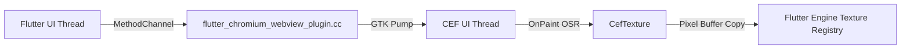

# Linux CEF Backend — Setup and Architecture

The Linux backend for `flutter_chromium_webview` uses the Chromium Embedded Framework (CEF) through Off-Screen Rendering (OSR) and Flutter textures.

## Requirements and System Libraries

### Operating System & Architecture
- **OS**: Linux desktop distributions (Ubuntu 20.04+, Debian 11+, Fedora 36+, Arch Linux, etc.)
- **Architecture**: `x64` (AMD64)
- **Display Server**: X11 display (or Wayland via XWayland). The plugin explicitly configures CEF for the X11 windowing backend.

### Development & Build Tools
Building a Flutter app with CEF on Linux requires:
- **Clang / LLVM** C++ compiler (supporting C++17)
- **CMake** 3.19 or newer
- **Ninja** (`ninja-build`)
- **pkg-config**
- **GTK 3** development libraries (`libgtk-3-dev`)
- **PulseAudio** or **ALSA** for audio playback (`libpulse-dev` / `pulseaudio`)

On Ubuntu / Debian systems:
```bash
sudo apt-get update
sudo apt-get install -y clang cmake ninja-build pkg-config libgtk-3-dev pulseaudio pulseaudio-utils
```

### Unprivileged User Namespaces
Chromium requires user namespaces for its sandbox confinement. If running in containers, WSL2, or hardened kernels (e.g., Ubuntu 24.04+ with AppArmor user namespace restrictions), ensure unprivileged user namespaces are permitted:
```bash
sudo sysctl -w kernel.apparmor_restrict_unprivileged_userns=0
```

## CEF Distribution and Automatic Download

CEF is a large binary (~100 MB compressed, ~1 GB uncompressed). The plugin does not bundle CEF inside the pub.dev package archive.

Instead, during your **first build**, CMake automatically:
1. Downloads the pinned, SHA-256 verified CEF `minimal` distribution:
   - Version: `149.0.4+g2f1bfd8+chromium-149.0.7827.156`
   - Archive: `cef_binary_149.0.4+g2f1bfd8+chromium-149.0.7827.156_linux64_minimal.tar.bz2`
2. Extracts it to the build cache directory.
3. Compiles `libcef_dll_wrapper` using Ninja.

### Offline Builds
To build without an internet connection, pre-download the tarball and pass the path to CMake via the `CEF_TARBALL` variable:
```bash
flutter build linux --dart-define=CEF_TARBALL=/path/to/cef_binary_..._linux64_minimal.tar.bz2
```

## Architecture and Rendering Pipeline



1. **Off-Screen Rendering (OSR)**: CEF renders pages into memory buffers without creating top-level native X11 windows.
2. **Pixel Buffer Flow**: Frames delivered via `CefRenderHandler::OnPaint` are copied into a stable frame buffer managed by `CefTexture`.
3. **Flutter Texture**: The texture is registered with the Flutter Engine's texture registry (`flutter::TextureRegistrar`), making the webview an ordinary Flutter widget that can be positioned, clipped, transformed, and layered.
4. **Message Loop Integration**: CEF runs its message pump cooperatively on the GTK main loop via `CefDoMessageLoopWork` scheduled by GTK timeouts.

## Input and Keyboard Handling

- **Mouse / Pointer Events**: Flutter pointer events (`PointerDownEvent`, `PointerMoveEvent`, `PointerUpEvent`, `PointerScrollEvent`) are transformed according to device pixel ratio and forwarded as CEF mouse events.
- **Keyboard & Focus**: Focus is managed between Flutter and CEF. When the widget has focus, key events are forwarded via X11 keycodes.
- **Context Menus & Dialogs**: CEF delegates JavaScript dialogs (`alert`, `confirm`, `prompt`) and context menus to Flutter widgets via `onJSDialog` and `onContextMenu`.

## Validation and Testing

To run the Linux validation test suite from the repository root:
```bash
./scripts/validate_linux.sh
```

Under WSLg (Windows Subsystem for Linux with GUI):
```bash
bash scripts/run_wsl.sh
```

## Known Limitations

- **Software Compositing**: Linux uses software pixel buffer copying between CEF and the Flutter Engine.
- **Wayland Native**: Running on pure Wayland without XWayland is not supported; X11 backend is required.
- **Codecs**: Standard CEF builds include open-source codecs (VP8, VP9, AV1, Opus, Vorbis). Proprietary codecs (H.264, AAC) are not licensed or included.
- **Process Lifetime**: Once `CefShutdown()` is called, CEF cannot be re-initialized in the same process; restarting the app is required.
